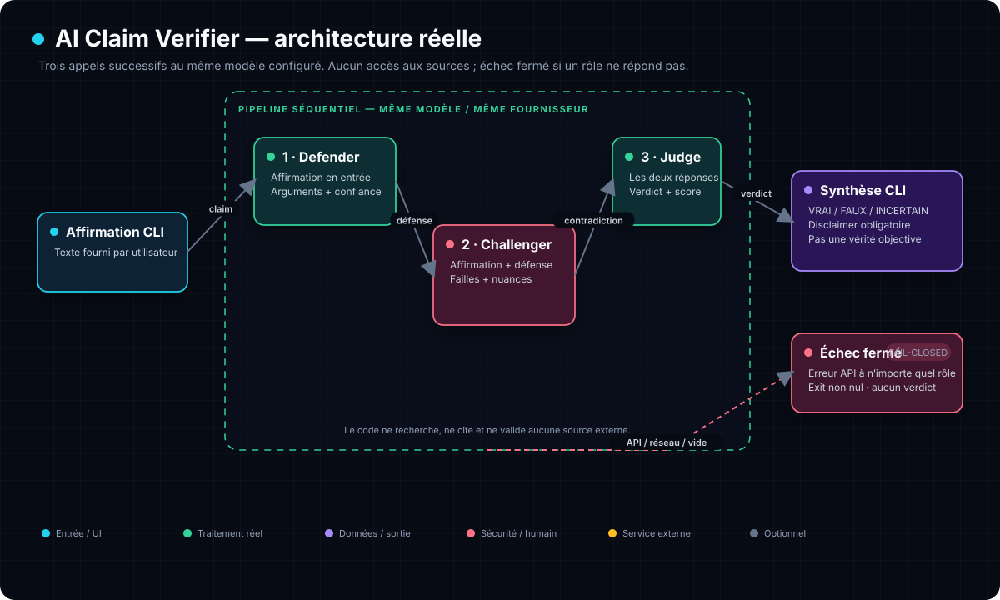

# ⚖️ AI Claim Verifier

<p align="center">
  <a href="README.md">English</a> &bull;
  <a href="README_fr.md">Français</a>
</p>

**Three AI roles confront a claim to produce a reasoned verdict.**

A claim is provided. Three AI agents debate it:

| Agent | Role |
|---|---|
| 🟢 **Defender** | Defends the claim with evidence |
| 🔴 **Challenger** | Contradicts it and finds the flaws |
| ⚖️ **Judge** | Decides: TRUE / FALSE / UNCERTAIN + confidence score |



The three roles are executed **sequentially by the same configured model**. The Challenger receives the defense, then the Judge receives both answers. The program performs no documentary research; any API error halts the pipeline with a non-zero code and no verdict.

## Why?

LLMs are trained to be **fluent**, not **true**. A single model can assert anything with confidence.

The protocol brings in three successive roles of a single model: defense,
contradiction and synthesis. This confrontation can surface objections,
but it **does not verify sources and does not establish an objective truth**.

## Installation

```bash
git clone https://github.com/Yukouf/ai-claim-verifier.git
cd ai-claim-verifier
```

## Usage

```bash
# With DeepSeek (default)
export DEEPSEEK_API_KEY=sk-...
python3 truth-debate.py "AI will replace developers by 2030"

# With OpenAI
export OPENAI_API_KEY=sk-...
export TRUTH_API_URL=https://api.openai.com/v1
export TRUTH_MODEL=gpt-4o
python3 truth-debate.py "Global warming is caused by humans"

# With Ollama (local)
export TRUTH_API_URL=http://localhost:11434/v1
export TRUTH_MODEL=qwen2.5
export OPENAI_API_KEY=ollama  # Ollama ignores the key but the format requires it
python3 truth-debate.py "Bitcoin will exceed 200k$ in 2025"
```

## Example output

```
══════════════════════════════════════════════════════
🎯 CLAIM: AI will replace developers by 2030
══════════════════════════════════════════════════════

🟢 DEFENDER: defending the claim...
Arguments: massive automation, scalability, no-code...
Score: 8/10

🔴 CHALLENGER: contradicting the claim...
Flaws: confusion between assistance and replacement, legacy code, accountability...
Contradiction score: 7/10

⚖️  JUDGE: ruling on the claim...
Verdict: UNCERTAIN (confidence 7/10)
CRUD developers are threatened, complex-systems developers are not.
```

## Fail-closed

This protocol **never** claims to establish the truth. If one of the agents does
not respond (missing key, network error, quota, non-2xx code, empty response...),
the debate stops immediately and the script exits with a **non-zero return
code**, **without** displaying any synthesis or verdict. No key is used if it
is absent, and no network call is attempted without a key.

```bash
# Without DEEPSEEK_API_KEY / OPENAI_API_KEY
python3 truth-debate.py "AI will replace developers by 2030"
# → ❌ Set DEEPSEEK_API_KEY or OPENAI_API_KEY   (exit code: 1)
```

## Tests

The tests (`python3 test_truth_debate.py`) verify the fail-closed behaviour
**without any real network call**: `urllib.request.urlopen` is replaced by a fake
that simulates success or failure.

```bash
python3 test_truth_debate.py
```

Cases covered: no key (`main` non-zero, zero network calls), failure of the 1st
agent, failure of one agent + no verdict, `debate()` raising `AgentAPIError`
(→ never a tainted "verdict" dict), nominal path → verdict and exit code 0, and
no secret key hard-coded in the source.

## Compatible with

- **DeepSeek** (default, inexpensive)
- **OpenAI** (GPT-4o, GPT-4)
- **Ollama** (local, free)
- **Groq, Together, Fireworks**: anything that speaks the OpenAI API

## Structure

```
ai-claim-verifier/
├── truth-debate.py       # The main script
├── truth-diagram.svg     # Current architecture
├── RESEARCH_ROADMAP.md   # Audit and roadmap
├── README.md             # This file
└── .gitignore
```

## License

MIT: do whatever you want with it.
